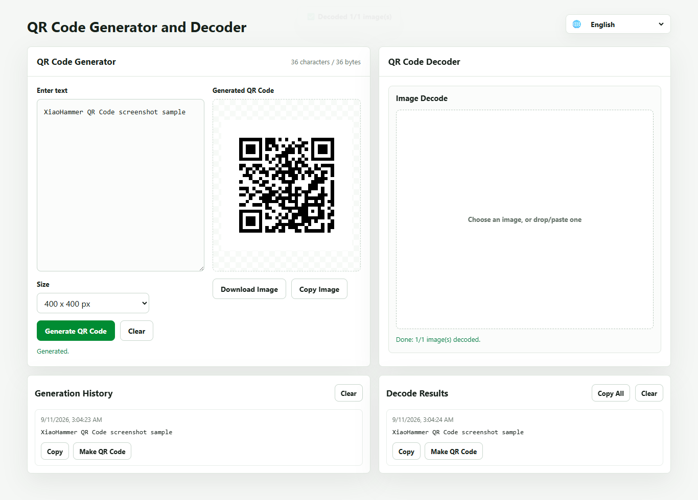

# XiaoHammer QR Code

[English](README.md) | [简体中文](README.zh-CN.md) | [繁體中文](README.zh-TW.md)

A privacy-friendly offline QR code generator and image decoder. It runs as a static web page, works directly from `file://`, and does not require a backend, account, CDN, or network request for its core features.

## Live Demo

GitHub Pages:

https://fionviber.github.io/XiaoHammerQRCode/

## Screenshot

## Features

- Generate QR codes from plain text
- Download the generated QR code as a PNG image
- Copy the generated QR code image when clipboard access is available
- Decode QR codes from uploaded, dragged, or pasted images
- Keep lightweight in-session records for generated text and decoded text
- Auto-detect English, Simplified Chinese, and Traditional Chinese from the browser language
- Allow manual language switching with a saved local preference
- Run fully offline after the page and vendored library are available locally

## Usage

Download the repository and open `index.html` in a modern browser.

You can also host the repository as a static site. No build step is required.

## Privacy

QR generation and image decoding happen in the browser. The page does not upload your text or images to a server. Session records stay in memory and are cleared when the page is closed or refreshed.

## Credits

See [CREDITS.md](CREDITS.md) for open-source library credits and third-party notices.

## License

This project is licensed under the [BSD Zero Clause License](LICENSE) (`0BSD`).
