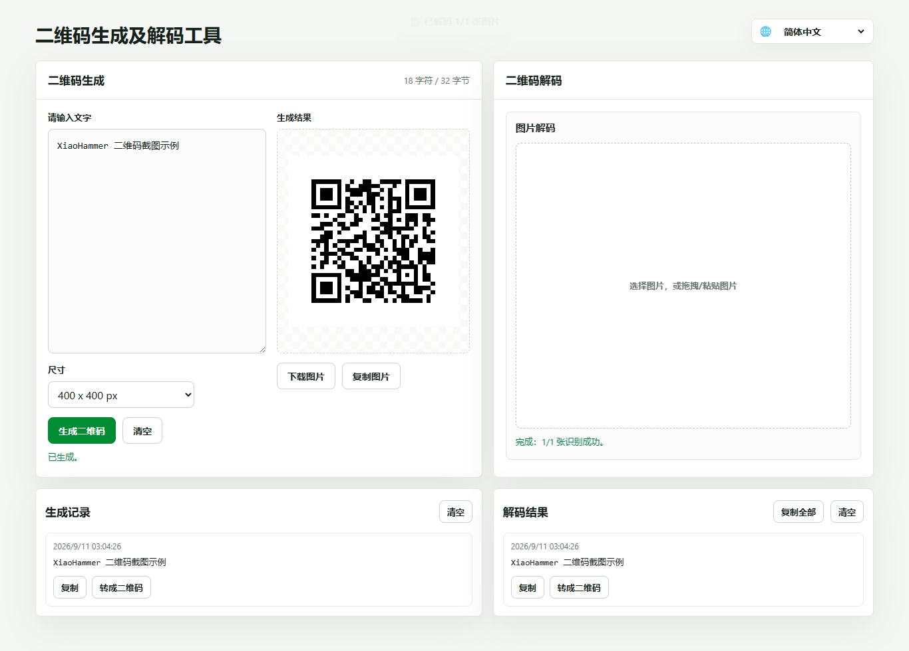

# XiaoHammer QR Code

[English](README.md) | [简体中文](README.zh-CN.md) | [繁體中文](README.zh-TW.md)

一个纯前端、纯离线的二维码生成和图片解码工具。它可以根据纯文本生成二维码，也可以直接在浏览器中解码本地图片里的二维码。

## 在线演示

GitHub Pages：

https://fionviber.github.io/XiaoHammerQRCode/

## 界面截图

## 功能

- 根据纯文本生成二维码
- 将生成的二维码下载为 PNG 图片
- 在浏览器允许剪贴板权限时复制二维码图片
- 从上传、拖拽或粘贴的图片中解码二维码
- 在当前会话中保留轻量的生成文本记录和解码文本记录
- 根据浏览器语言自动识别英语、简体中文、繁体中文
- 支持手动切换语言，并将偏好保存在本地
- 为生成、清空、复制、下载、解码和记录操作提供轻量 emoji 提示
- 页面和本地打包库可用后，核心功能可以完全离线运行

## 使用

下载仓库后，用现代浏览器打开 `index.html`。

你也可以把这个仓库作为静态站点托管，不需要构建步骤。

## 隐私

二维码生成和图片解码都在浏览器中完成。页面不会把你的文本或图片上传到服务器，核心二维码工具也不需要后端、账号、CDN 或网络请求。

## 致谢

二维码生成和图片解码由内置的 ZXing Browser 库提供支持。

开源库致谢和第三方说明见 [CREDITS.md](CREDITS.md) 和 [THIRD_PARTY_NOTICES.md](THIRD_PARTY_NOTICES.md)。

## 免责声明

本项目按“现状”提供，不作任何形式的保证。二维码的识别效果可能受到图片质量、光照、裁剪和设备行为影响；用于重要场景时，仍建议人工检查。

## 开源许可

本项目原创代码和文档使用 [Zero-Clause BSD License](LICENSE)（`0BSD`）。

内置的第三方库代码继续遵循其原始许可证。
