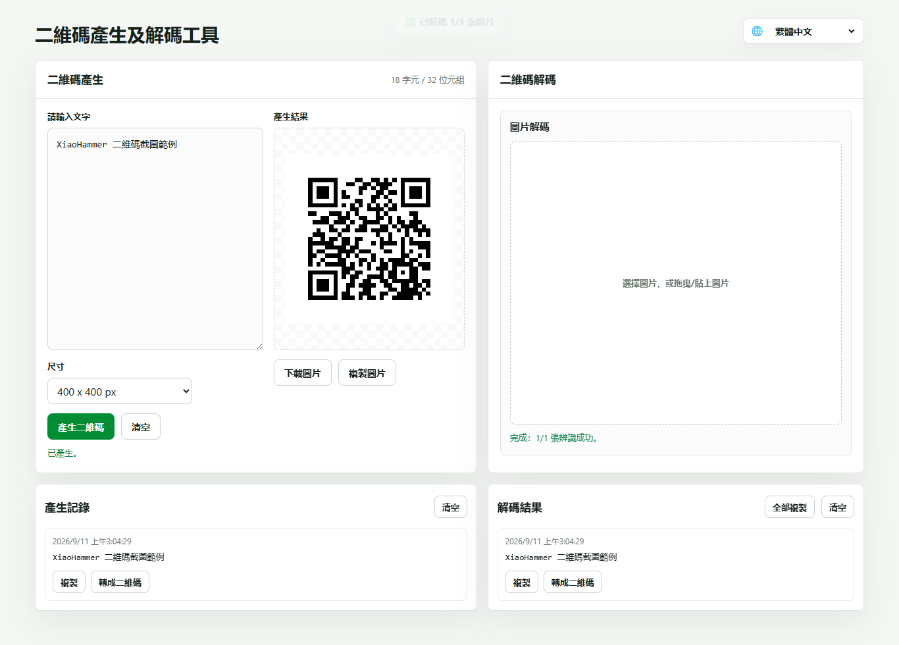

# QR Code

[English](README.md) | [简体中文](README.zh-CN.md) | [繁體中文](README.zh-TW.md)

一個純前端、純離線的二維碼產生和圖片解碼工具。它可以根據純文字產生二維碼，也可以直接在瀏覽器中解碼本機圖片裡的二維碼。

## 線上示範

GitHub Pages：

https://fionviber.github.io/QRCode/

## 介面截圖

## 功能

- 根據純文字產生二維碼
- 將產生的二維碼下載為 PNG 圖片
- 在瀏覽器允許剪貼簿權限時複製二維碼圖片
- 從上傳、拖曳或貼上的圖片中解碼二維碼
- 在目前工作階段中保留輕量的產生文字記錄和解碼文字記錄
- 根據瀏覽器語言自動識別英文、簡體中文、繁體中文
- 支援手動切換語言，並將偏好保存在本機
- 為產生、清空、複製、下載、解碼和記錄操作提供輕量 emoji 提示
- 頁面和本地打包函式庫可用後，核心功能可以完全離線執行

## 使用

下載倉庫後，用現代瀏覽器開啟 `index.html`。

你也可以把這個倉庫作為靜態網站託管，不需要建置步驟。

## 隱私

二維碼產生和圖片解碼都在瀏覽器中完成。頁面不會把你的文字或圖片上傳到伺服器，核心二維碼工具也不需要後端、帳號、CDN 或網路請求。

## 致謝

二維碼產生和圖片解碼由內建的 ZXing Browser 函式庫提供支援。

開源函式庫致謝和第三方說明見 [CREDITS.md](CREDITS.md) 和 [THIRD_PARTY_NOTICES.md](THIRD_PARTY_NOTICES.md)。

## 免責聲明

本專案按「現狀」提供，不作任何形式的保證。二維碼的辨識效果可能受到圖片品質、光線、裁切和裝置行為影響；用於重要場景時，仍建議人工檢查。

## 開源授權

本專案原創程式碼和文件使用 [Zero-Clause BSD License](LICENSE)（`0BSD`）。

內建的第三方函式庫程式碼繼續遵循其原始授權。
